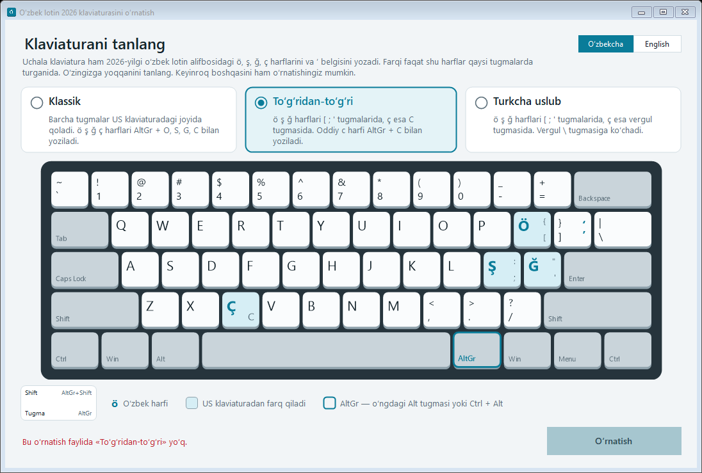
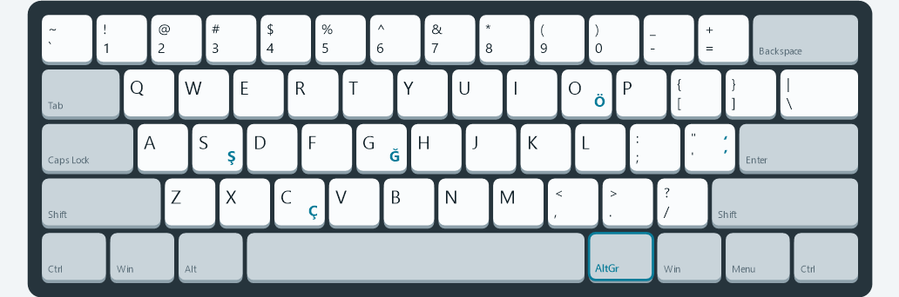
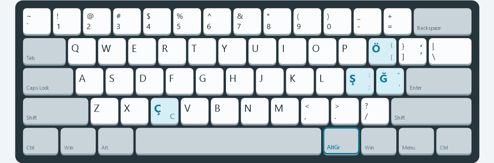
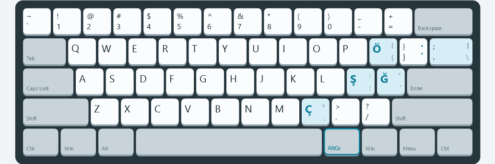
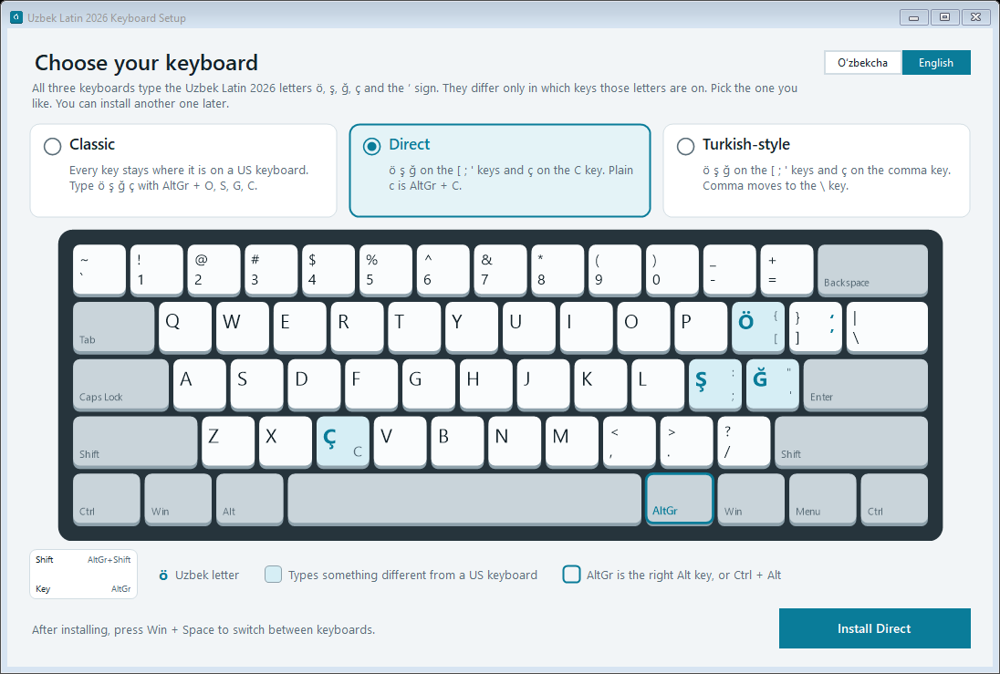

# Uzbek Latin 2026 Keyboard

Windows uchun oʻzbek lotin 2026 klaviaturalari · Uzbek Latin 2026 keyboard layouts for Windows

**Yuklab olish / Download: [UzbekKeyboardSetup.exe](https://github.com/discoveruz/uzbek-keyboard-layout/releases/latest/download/UzbekKeyboardSetup.exe)**

[Oʻzbekcha](#uzbek) · [English](#english)

## Oʻzbekcha

Bu loyihada Windows uchun uchta klaviatura va ularni oʻrnatadigan dastur bor. Uchalasi ham 2026-yilgi oʻzbek lotin alifbosidagi **ö, ş, ğ, ç** harflarini hamda **ʼ** (tutuq belgisi) va **ʻ** belgilarini yozadi. Farqi faqat shu harflar qaysi tugmalarda turganida.

### Uchta klaviatura

Rasmlarni qanday oʻqish kerak: har bir tugmaning chap pastida tugmaning oʻzi, chap yuqorisida <kbd>Shift</kbd> bilan, oʻng pastida <kbd>AltGr</kbd> bilan, oʻng yuqorisida <kbd>AltGr</kbd>+<kbd>Shift</kbd> bilan yoziladigan belgi. <kbd>AltGr</kbd> — oʻngdagi <kbd>Alt</kbd> tugmasi. Klaviaturangizda oʻngdagi <kbd>Alt</kbd> boʻlmasa, <kbd>AltGr</kbd> oʻrniga <kbd>Ctrl</kbd>+<kbd>Alt</kbd> ni bosing. Moviy rangdagi tugmalar oddiy US klaviaturadan farq qiladi.

#### Klassik · Uzbek Latin 2026 (Classic)

Barcha tugmalar US klaviaturadagi joyida qoladi. Oʻzbek harflari <kbd>AltGr</kbd> bilan yoziladi.

#### Toʻgʻridan-toʻgʻri · Uzbek Latin 2026 (Direct)

ö ş ğ ç harflari alohida tugmalarda, <kbd>AltGr</kbd> kerak emas. ç — <kbd>C</kbd> tugmasida, oddiy c — <kbd>AltGr</kbd>+<kbd>C</kbd>.

#### Turkcha uslub · Uzbek Latin 2026 (Turkish-style)

ö ş ğ xuddi Toʻgʻridan-toʻgʻridagidek, ç esa vergul tugmasida. Vergul turk Q klaviaturasidagidek <kbd>\\</kbd> tugmasiga koʻchadi.

#### Qaysi belgi qayerda

Bosh harf uchun <kbd>Shift</kbd> qoʻshing.

| Belgi | Klassik | Toʻgʻridan-toʻgʻri | Turkcha uslub |
|---|---|---|---|
| ö | <kbd>AltGr</kbd>+<kbd>O</kbd> | <kbd>[</kbd> | <kbd>[</kbd> |
| ş | <kbd>AltGr</kbd>+<kbd>S</kbd> | <kbd>;</kbd> | <kbd>;</kbd> |
| ğ | <kbd>AltGr</kbd>+<kbd>G</kbd> | <kbd>'</kbd> | <kbd>'</kbd> |
| ç | <kbd>AltGr</kbd>+<kbd>C</kbd> | <kbd>C</kbd> | <kbd>,</kbd> |
| ʼ | <kbd>AltGr</kbd>+<kbd>'</kbd> | <kbd>AltGr</kbd>+<kbd>]</kbd> | <kbd>AltGr</kbd>+<kbd>]</kbd> |
| ʻ | <kbd>AltGr</kbd>+<kbd>Shift</kbd>+<kbd>'</kbd> | <kbd>AltGr</kbd>+<kbd>Shift</kbd>+<kbd>]</kbd> | <kbd>AltGr</kbd>+<kbd>Shift</kbd>+<kbd>]</kbd> |
| c | <kbd>C</kbd> | <kbd>AltGr</kbd>+<kbd>C</kbd> | <kbd>C</kbd> |
| , (vergul) | <kbd>,</kbd> | <kbd>,</kbd> | <kbd>\\</kbd> yoki / or <kbd>AltGr</kbd>+<kbd>,</kbd> |

Tugmadan joy boʻshatgan eski belgi (masalan <kbd>[</kbd>, <kbd>;</kbd>, <kbd>'</kbd>) oʻsha tugmaning oʻzida <kbd>AltGr</kbd> bilan yoziladi.

### Oʻrnatish

1. **[UzbekKeyboardSetup.exe](https://github.com/discoveruz/uzbek-keyboard-layout/releases/latest/download/UzbekKeyboardSetup.exe)** faylini yuklab oling.
2. Faylni oching. *Windows protected your PC* oynasi chiqsa, **More info**, keyin **Run anyway** ni bosing. Dastur raqamli imzoga ega boʻlmagani uchun Windows shunday ogohlantiradi.
3. Oʻzingizga yoqqan klaviaturani tanlang va **Oʻrnatish** ni bosing.
4. Windows ruxsat soʻrasa, **Ha** (Yes) ni bosing.
5. <kbd>Win</kbd>+<kbd>Space</kbd> ni bosib, roʻyxatdan **Uzbek Latin 2026 (…)** ni tanlang. Roʻyxatda boʻlmasa, tizimdan chiqib, qayta kiring.

Bir nechta klaviaturani oʻrnatib, ular orasida <kbd>Win</kbd>+<kbd>Space</kbd> bilan almashib turish mumkin.

### Oʻchirish

Oʻrnatish dasturini qayta oching, klaviaturani tanlang va **Oʻchirish** ni bosing. Yoki Windowsda: **Sozlamalar → Ilovalar → Oʻrnatilgan ilovalar → Uzbek Latin 2026 (…) → Oʻchirish**.

### Talablar

- Windows 10 yoki 11.
- Intel yoki AMD protsessorli kompyuter. ARM protsessorli kompyuterlarga (masalan, Snapdragon) oʻrnatilmaydi, chunki MSKLC ular uchun klaviatura yarata olmaydi.
- Boshqa hech narsa oʻrnatish shart emas.

## English

This project has three Windows keyboard layouts and a setup program that installs them. All three type the Uzbek Latin 2026 letters **ö, ş, ğ, ç** and the **ʼ** (tutuq belgisi) and **ʻ** signs. They differ only in which keys those letters are on.

### The three layouts

How to read the pictures: each key shows what it types alone (bottom left), with <kbd>Shift</kbd> (top left), with <kbd>AltGr</kbd> (bottom right) and with <kbd>AltGr</kbd>+<kbd>Shift</kbd> (top right). <kbd>AltGr</kbd> is the right <kbd>Alt</kbd> key. If your keyboard has no right <kbd>Alt</kbd>, press <kbd>Ctrl</kbd>+<kbd>Alt</kbd> instead of <kbd>AltGr</kbd>. Blue keys type something different from a US keyboard.

- **Classic**, shown in Windows as *Uzbek Latin 2026 (Classic)*: every key stays where it is on a US keyboard, and you type the Uzbek letters with <kbd>AltGr</kbd>.
- **Direct**, shown as *Uzbek Latin 2026 (Direct)*: ö ş ğ ç have their own keys, so no <kbd>AltGr</kbd> is needed. ç is on <kbd>C</kbd>, and plain c is <kbd>AltGr</kbd>+<kbd>C</kbd>.
- **Turkish-style**, shown as *Uzbek Latin 2026 (Turkish-style)*: like Direct, but ç is on the comma key and the comma moves to <kbd>\\</kbd>, as on a Turkish Q keyboard.

See the pictures and the table in the Uzbek section above. The table columns are Classic, Direct and Turkish-style. Hold <kbd>Shift</kbd> for capitals. A symbol that gave up its key to a letter, such as <kbd>[</kbd>, <kbd>;</kbd> or <kbd>'</kbd>, is still on that key with <kbd>AltGr</kbd>.

### How to install

1. Download **[UzbekKeyboardSetup.exe](https://github.com/discoveruz/uzbek-keyboard-layout/releases/latest/download/UzbekKeyboardSetup.exe)**.
2. Open it. If *Windows protected your PC* appears, click **More info**, then **Run anyway**. Windows shows this because the program isn't digitally signed.
3. Pick the layout you like and click **Install**. The window opens in Uzbek; use the switch in the top-right corner for English.
4. When Windows asks for permission, choose **Yes**.
5. Press <kbd>Win</kbd>+<kbd>Space</kbd> and choose **Uzbek Latin 2026 (…)**. If it isn't listed yet, sign out and back in.

You can install more than one layout and switch between them with <kbd>Win</kbd>+<kbd>Space</kbd>.

### How to remove

Open the setup program again, pick the layout and click **Remove**. Or in Windows: **Settings → Apps → Installed apps → Uzbek Latin 2026 (…) → Uninstall**.

### Requirements

- Windows 10 or 11.
- A PC with an Intel or AMD processor. PCs with ARM processors (such as Snapdragon) aren't supported, because MSKLC can't build keyboards for them.
- Nothing else to install.

## Build from source

You need:

- Windows with [Microsoft Keyboard Layout Creator 1.4](https://www.microsoft.com/en-us/download/details.aspx?id=102134) (MSKLC).
- The [.NET SDK](https://dotnet.microsoft.com/download) and the .NET Framework 4.8 targeting pack. Visual Studio's *.NET desktop development* workload installs both.

Steps:

1. In MSKLC, open each `.klc` file (**File → Load Source File**) and run **Project → Build DLL and Setup Package**. MSKLC writes each package to `Documents\<keyboard name>`.
2. Run `.\build-installer.ps1`. It copies the three packages in, checks that none is older than its `.klc` file, and builds `dist\UzbekKeyboardSetup.exe`.

To change a layout, edit its `.klc` file in MSKLC, use **Project → Validate Layout**, then repeat the two steps. The pictures in the setup program are read from the `.klc` files, so they update on their own.

| Path | What it is |
|---|---|
| `Uzbek-Latin-2026-Classic.klc` `Uzbek-Latin-2026-Direct.klc` `Uzbek-Latin-2026-Turkish-style.klc` | The three layouts, in MSKLC's source format (UTF-16) |
| `installer/` | The setup program (C#, Windows Forms, .NET Framework 4.8) |
| `build-installer.ps1` | Packs the MSKLC packages into the setup program and builds it |
| `docs/images/` | The pictures in this README. Regenerate them with `installer\bin\Release\net48\UzbekKeyboardSetup.exe --render-images docs\images` |

## License

[MIT](LICENSE) © 2026 Diyorbek Satimboyev
