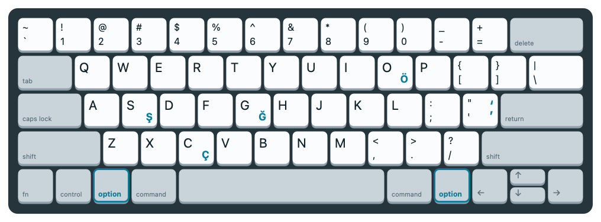
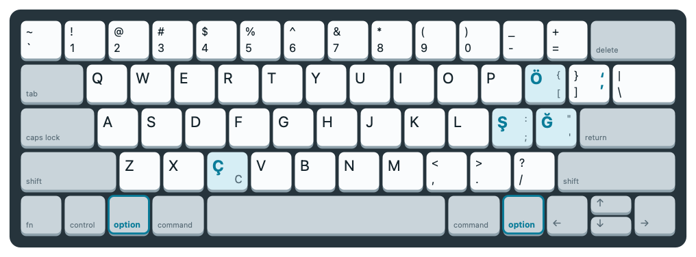
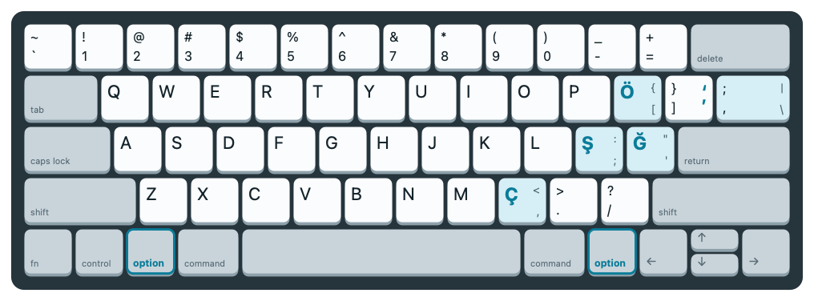
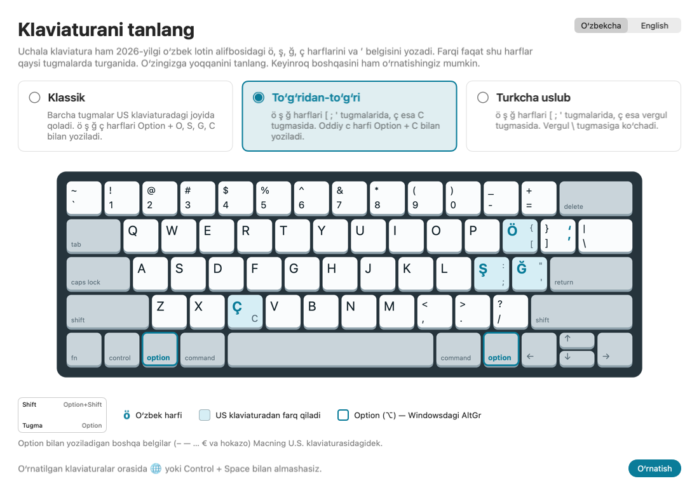
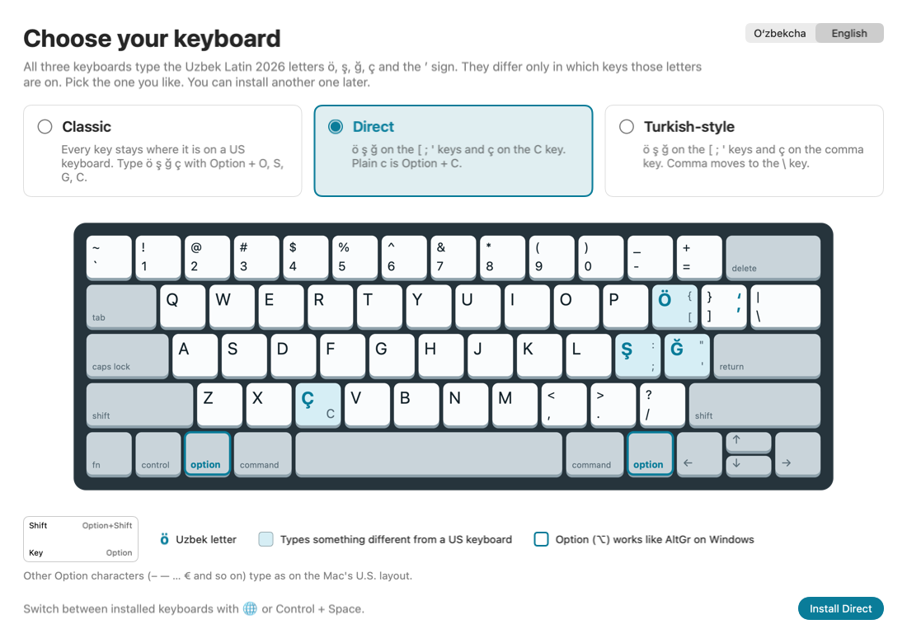

# Uzbek Latin 2026 Keyboard

Windows, Mac va Linux uchun oʻzbek lotin 2026 klaviaturalari · Uzbek Latin 2026 keyboard layouts for Windows, Mac and Linux

**Yuklab olish / Download:** Windows: **[UzbekKeyboardSetup.exe](https://github.com/discoveruz/uzbek-keyboard-layout/releases/latest/download/UzbekKeyboardSetup.exe)** · Mac: **[UzbekKeyboardSetup.zip](https://github.com/discoveruz/uzbek-keyboard-layout/releases/latest/download/UzbekKeyboardSetup.zip)** · Linux: **[UzbekKeyboardLinux.tar.gz](https://github.com/discoveruz/uzbek-keyboard-layout/releases/latest/download/UzbekKeyboardLinux.tar.gz)**

[Oʻzbekcha](#uzbek) · [English](#english)

## Oʻzbekcha

Bu loyihada Windows, Mac va Linux uchun uchta klaviatura hamda ularni oʻrnatadigan dasturlar bor. Uchalasi ham 2026-yilgi oʻzbek lotin alifbosidagi **ö, ş, ğ, ç** harflarini hamda **ʼ** (tutuq belgisi) va **ʻ** belgilarini yozadi. Farqi faqat shu harflar qaysi tugmalarda turganida.

### Uchta klaviatura

Rasmlarni qanday oʻqish kerak: har bir tugmaning chap pastida tugmaning oʻzi, chap yuqorisida <kbd>Shift</kbd> bilan, oʻng pastida <kbd>AltGr</kbd> bilan, oʻng yuqorisida <kbd>AltGr</kbd>+<kbd>Shift</kbd> bilan yoziladigan belgi. <kbd>AltGr</kbd> — oʻngdagi <kbd>Alt</kbd> tugmasi. Klaviaturangizda oʻngdagi <kbd>Alt</kbd> boʻlmasa, <kbd>AltGr</kbd> oʻrniga <kbd>Ctrl</kbd>+<kbd>Alt</kbd> ni bosing. Moviy rangdagi tugmalar oddiy US klaviaturadan farq qiladi.

#### Klassik · Uzbek Latin 2026 (Classic)

Barcha tugmalar US klaviaturadagi joyida qoladi. Oʻzbek harflari <kbd>AltGr</kbd> bilan yoziladi.

#### Toʻgʻridan-toʻgʻri · Uzbek Latin 2026 (Direct)

ö ş ğ ç harflari alohida tugmalarda, <kbd>AltGr</kbd> kerak emas. ç — <kbd>C</kbd> tugmasida, oddiy c — <kbd>AltGr</kbd>+<kbd>C</kbd>.

#### Turkcha uslub · Uzbek Latin 2026 (Turkish-style)

ö ş ğ xuddi Toʻgʻridan-toʻgʻridagidek, ç esa vergul tugmasida. Vergul turk Q klaviaturasidagidek <kbd>\\</kbd> tugmasiga koʻchadi.

#### Qaysi belgi qayerda

Bosh harf uchun <kbd>Shift</kbd> qoʻshing.

| Belgi | Klassik | Toʻgʻridan-toʻgʻri | Turkcha uslub |
|---|---|---|---|
| ö | <kbd>AltGr</kbd>+<kbd>O</kbd> | <kbd>[</kbd> | <kbd>[</kbd> |
| ş | <kbd>AltGr</kbd>+<kbd>S</kbd> | <kbd>;</kbd> | <kbd>;</kbd> |
| ğ | <kbd>AltGr</kbd>+<kbd>G</kbd> | <kbd>'</kbd> | <kbd>'</kbd> |
| ç | <kbd>AltGr</kbd>+<kbd>C</kbd> | <kbd>C</kbd> | <kbd>,</kbd> |
| ʼ | <kbd>AltGr</kbd>+<kbd>'</kbd> | <kbd>AltGr</kbd>+<kbd>]</kbd> | <kbd>AltGr</kbd>+<kbd>]</kbd> |
| ʻ | <kbd>AltGr</kbd>+<kbd>Shift</kbd>+<kbd>'</kbd> | <kbd>AltGr</kbd>+<kbd>Shift</kbd>+<kbd>]</kbd> | <kbd>AltGr</kbd>+<kbd>Shift</kbd>+<kbd>]</kbd> |
| c | <kbd>C</kbd> | <kbd>AltGr</kbd>+<kbd>C</kbd> | <kbd>C</kbd> |
| , (vergul) | <kbd>,</kbd> | <kbd>,</kbd> | <kbd>\\</kbd> yoki / or <kbd>AltGr</kbd>+<kbd>,</kbd> |

Tugmadan joy boʻshatgan eski belgi (masalan <kbd>[</kbd>, <kbd>;</kbd>, <kbd>'</kbd>) oʻsha tugmaning oʻzida <kbd>AltGr</kbd> bilan yoziladi.

#### Macda

Macda klaviaturalar xuddi shunday, faqat <kbd>AltGr</kbd> oʻrniga <kbd>Option</kbd> (⌥) ni bosasiz: chapdagisini ham, oʻngdagisini ham. Oʻzbek harflari egallamagan tugmalarda <kbd>Option</kbd> odatdagidek ishlaydi: – — … € kabi belgilar va é ü ñ kabi urgʻuli harflar Macning U.S. klaviaturasidagidek yoziladi. <kbd>⌘</kbd> bilan bosiladigan buyruqlar US klaviaturadagi joyida qoladi: masalan, Toʻgʻridan-toʻgʻri klaviaturada <kbd>C</kbd> tugmasi ç yozsa ham, <kbd>⌘</kbd>+<kbd>C</kbd> nusxa oladi.

Mac klaviaturasida uchala klaviatura shunday koʻrinadi. Bu yerda tugmaning oʻng tomonida faqat oʻzbek klaviaturasi <kbd>Option</kbd> ga qoʻygan belgilar koʻrsatilgan.

**Klassik**

**Toʻgʻridan-toʻgʻri**

**Turkcha uslub**

### Oʻrnatish

#### Windows

1. **[UzbekKeyboardSetup.exe](https://github.com/discoveruz/uzbek-keyboard-layout/releases/latest/download/UzbekKeyboardSetup.exe)** faylini yuklab oling.
2. Faylni oching. *Windows protected your PC* oynasi chiqsa, **More info**, keyin **Run anyway** ni bosing. Dastur raqamli imzoga ega boʻlmagani uchun Windows shunday ogohlantiradi.
3. Oʻzingizga yoqqan klaviaturani tanlang va **Oʻrnatish** ni bosing.
4. Windows ruxsat soʻrasa, **Ha** (Yes) ni bosing.
5. <kbd>Win</kbd>+<kbd>Space</kbd> ni bosib, roʻyxatdan **Uzbek Latin 2026 (…)** ni tanlang. Roʻyxatda boʻlmasa, tizimdan chiqib, qayta kiring.

Bir nechta klaviaturani oʻrnatib, ular orasida <kbd>Win</kbd>+<kbd>Space</kbd> bilan almashib turish mumkin.

#### Mac

1. **[UzbekKeyboardSetup.zip](https://github.com/discoveruz/uzbek-keyboard-layout/releases/latest/download/UzbekKeyboardSetup.zip)** faylini yuklab oling va oching. Undan **UzbekKeyboardSetup** dasturi chiqadi.
2. Dasturni oching. macOS uni ochmasa, **Done** (yoki **OK**) ni bosing, keyin **System Settings → Privacy & Security** ni ochib, pastroqdagi **Open Anyway** ni, soʻng **Open** ni bosing. Dastur raqamli imzoga ega boʻlmagani uchun macOS shunday ogohlantiradi.
3. Oʻzingizga yoqqan klaviaturani tanlang va **Oʻrnatish** ni bosing. Parol soʻralmaydi va klaviatura darhol yoqiladi.
4. Klaviaturalar orasida <kbd>🌐</kbd> (<kbd>fn</kbd>), <kbd>Control</kbd>+<kbd>Space</kbd> yoki menyu satridagi **UZ** belgisi bilan almashasiz.

Klaviatura faqat sizning foydalanuvchi hisobingizga oʻrnatiladi. Macdagi boshqa hisoblar uchun dasturni oʻsha hisobda ham oching.

#### Linux

1. **[UzbekKeyboardLinux.tar.gz](https://github.com/discoveruz/uzbek-keyboard-layout/releases/latest/download/UzbekKeyboardLinux.tar.gz)** faylini yuklab oling.
2. Terminalda fayl turgan papkada `tar xzf UzbekKeyboardLinux.tar.gz` ni, keyin `./UzbekKeyboardLinux/install.sh` ni ishga tushiring. sudo kerak emas.
3. Qaysi klaviatura yoqilishini raqami bilan tanlang. Uchalasi ham oʻrnatiladi, GNOMEda esa tanlangani kiritish manbalariga oʻzi qoʻshiladi.
4. Tizimdan chiqib, qayta kiring. KDE Plasma va boshqa ish stollarida klaviaturani sozlamalarda qoʻshing: u **Uzbek Latin 2026 (…)** deb ataladi.

Tugmalar Windowsdagidek: <kbd>AltGr</kbd> — oʻngdagi <kbd>Alt</kbd>. Klaviaturalar faqat Wayland seansida ishlaydi (Ubuntu va Fedorada odatiy seans shu). X11 seansida ular koʻrinmaydi: kirish oynasida Wayland seansini tanlang. Klaviatura faqat sizning foydalanuvchi hisobingizga oʻrnatiladi.

### Oʻchirish

**Windows:** oʻrnatish dasturini qayta oching, klaviaturani tanlang va **Oʻchirish** ni bosing. Yoki Windowsda: **Sozlamalar → Ilovalar → Oʻrnatilgan ilovalar → Uzbek Latin 2026 (…) → Oʻchirish**.

**Mac:** dasturni qayta oching, klaviaturani tanlang va **Oʻchirish** ni bosing. Dastur System Settings ni ochib, nimani bosish kerakligini koʻrsatadi: macOS bunday klaviaturalarni faqat u yerda olib tashlashga ruxsat beradi. Oxirgi oʻzbek klaviaturasi olib tashlangach, dastur fayllarni ham oʻchiradi.

**Linux:** `./UzbekKeyboardLinux/install.sh --remove` ni ishga tushiring, keyin tizimdan chiqib, qayta kiring. Uchala klaviatura ham olib tashlanadi.

### Talablar

**Windows:**

- Windows 10 yoki 11.
- Intel yoki AMD protsessorli kompyuter. ARM protsessorli kompyuterlarga (masalan, Snapdragon) oʻrnatilmaydi, chunki MSKLC ular uchun klaviatura yarata olmaydi.
- Boshqa hech narsa oʻrnatish shart emas.

**Mac:**

- macOS 13 (Ventura) yoki yangiroq (macOS 26 da sinab koʻrilgan).
- Intel yoki Apple silicon (M1 va yangiroq) protsessorli istalgan Mac.
- Boshqa hech narsa oʻrnatish shart emas.

**Linux:**

- Wayland seansi: GNOME, KDE Plasma va boshqalar. Ubuntu 22.04, Ubuntu 24.04 va Fedorada tekshirilgan. X11 seanslarida ishlamaydi.
- Boshqa hech narsa oʻrnatish shart emas.

## English

This project has three keyboard layouts for Windows, Mac and Linux, and an installer for each system. All three type the Uzbek Latin 2026 letters **ö, ş, ğ, ç** and the **ʼ** (tutuq belgisi) and **ʻ** signs. They differ only in which keys those letters are on.

### The three layouts

How to read the pictures: each key shows what it types alone (bottom left), with <kbd>Shift</kbd> (top left), with <kbd>AltGr</kbd> (bottom right) and with <kbd>AltGr</kbd>+<kbd>Shift</kbd> (top right). <kbd>AltGr</kbd> is the right <kbd>Alt</kbd> key. If your keyboard has no right <kbd>Alt</kbd>, press <kbd>Ctrl</kbd>+<kbd>Alt</kbd> instead of <kbd>AltGr</kbd>. Blue keys type something different from a US keyboard.

- **Classic**, shown in Windows as *Uzbek Latin 2026 (Classic)*: every key stays where it is on a US keyboard, and you type the Uzbek letters with <kbd>AltGr</kbd>.
- **Direct**, shown as *Uzbek Latin 2026 (Direct)*: ö ş ğ ç have their own keys, so no <kbd>AltGr</kbd> is needed. ç is on <kbd>C</kbd>, and plain c is <kbd>AltGr</kbd>+<kbd>C</kbd>.
- **Turkish-style**, shown as *Uzbek Latin 2026 (Turkish-style)*: like Direct, but ç is on the comma key and the comma moves to <kbd>\\</kbd>, as on a Turkish Q keyboard.

See the pictures and the table in the Uzbek section above. The table columns are Classic, Direct and Turkish-style. Hold <kbd>Shift</kbd> for capitals. A symbol that gave up its key to a letter, such as <kbd>[</kbd>, <kbd>;</kbd> or <kbd>'</kbd>, is still on that key with <kbd>AltGr</kbd>.

#### On a Mac

The layouts are the same on a Mac, but you press <kbd>Option</kbd> (⌥) where the pictures say <kbd>AltGr</kbd>; either Option key works. On keys the Uzbek letters don't use, <kbd>Option</kbd> works as usual: symbols such as – — … € and accented letters such as é ü ñ type as on the Mac's U.S. layout. Shortcuts with <kbd>⌘</kbd> stay where they are on a US keyboard: on Direct, for example, the <kbd>C</kbd> key types ç, but <kbd>⌘</kbd>+<kbd>C</kbd> still copies. The Uzbek section above also has pictures of the three layouts on a Mac keyboard.

### How to install

#### Windows

1. Download **[UzbekKeyboardSetup.exe](https://github.com/discoveruz/uzbek-keyboard-layout/releases/latest/download/UzbekKeyboardSetup.exe)**.
2. Open it. If *Windows protected your PC* appears, click **More info**, then **Run anyway**. Windows shows this because the program isn't digitally signed.
3. Pick the layout you like and click **Install**. The window opens in Uzbek; use the switch in the top-right corner for English.
4. When Windows asks for permission, choose **Yes**.
5. Press <kbd>Win</kbd>+<kbd>Space</kbd> and choose **Uzbek Latin 2026 (…)**. If it isn't listed yet, sign out and back in.

You can install more than one layout and switch between them with <kbd>Win</kbd>+<kbd>Space</kbd>.

#### Mac

1. Download **[UzbekKeyboardSetup.zip](https://github.com/discoveruz/uzbek-keyboard-layout/releases/latest/download/UzbekKeyboardSetup.zip)** and open it. It unpacks into the **UzbekKeyboardSetup** app.
2. Open the app. If macOS won't open it, click **Done** (or **OK**), open **System Settings → Privacy & Security**, scroll down and click **Open Anyway**, then **Open**. macOS shows this because the app isn't digitally signed.
3. Pick the layout you like and click **Install**. There's no password, and the layout is turned on right away. The window opens in Uzbek; use the switch in the top-right corner for English.
4. Switch between keyboards with <kbd>🌐</kbd> (<kbd>fn</kbd>), <kbd>Control</kbd>+<kbd>Space</kbd> or the **UZ** icon in the menu bar.

The layout is installed for your user account only. For another account on the same Mac, open the app in that account too.

#### Linux

1. Download **[UzbekKeyboardLinux.tar.gz](https://github.com/discoveruz/uzbek-keyboard-layout/releases/latest/download/UzbekKeyboardLinux.tar.gz)**.
2. In a terminal, in the folder with the file, run `tar xzf UzbekKeyboardLinux.tar.gz`, then `./UzbekKeyboardLinux/install.sh`. It doesn't need sudo.
3. Pick the layout to turn on by its number. All three are installed, and on GNOME the one you picked is added to your input sources.
4. Log out and back in. On KDE Plasma and other desktops, add the layout in your keyboard settings; it's called **Uzbek Latin 2026 (…)**.

The keys are the same as on Windows: <kbd>AltGr</kbd> is the right <kbd>Alt</kbd>. The layouts only work in a Wayland session (the usual one on Ubuntu and Fedora). In an X11 session they don't show up; pick a Wayland session on the login screen. The layouts are installed for your user account only.

### How to remove

**Windows:** open the setup program again, pick the layout and click **Remove**. Or in Windows: **Settings → Apps → Installed apps → Uzbek Latin 2026 (…) → Uninstall**.

**Mac:** open the app again, pick the layout and click **Remove**. The app opens System Settings and shows what to click there, because macOS only lets you take layouts like these out in System Settings. Once the last Uzbek layout is out, the app also deletes its files.

**Linux:** run `./UzbekKeyboardLinux/install.sh --remove`, then log out and back in. It takes out all three layouts.

### Requirements

**Windows:**

- Windows 10 or 11.
- A PC with an Intel or AMD processor. PCs with ARM processors (such as Snapdragon) aren't supported, because MSKLC can't build keyboards for them.
- Nothing else to install.

**Mac:**

- macOS 13 (Ventura) or later (tested on macOS 26).
- Any Mac with an Intel or Apple silicon (M1 or later) processor.
- Nothing else to install.

**Linux:**

- A Wayland session: GNOME, KDE Plasma and others. Checked on Ubuntu 22.04, Ubuntu 24.04 and Fedora. X11 sessions aren't supported.
- Nothing else to install.

## Build from source

### Windows

You need:

- Windows with [Microsoft Keyboard Layout Creator 1.4](https://www.microsoft.com/en-us/download/details.aspx?id=102134) (MSKLC).
- The [.NET SDK](https://dotnet.microsoft.com/download) and the .NET Framework 4.8 targeting pack. Visual Studio's *.NET desktop development* workload installs both.

Steps:

1. In MSKLC, open each `.klc` file (**File → Load Source File**) and run **Project → Build DLL and Setup Package**. MSKLC writes each package to `Documents\<keyboard name>`.
2. Run `.\build-installer.ps1`. It copies the three packages in, checks that none is older than its `.klc` file, and builds `dist\UzbekKeyboardSetup.exe`.

To change a layout, edit its `.klc` file in MSKLC, use **Project → Validate Layout**, then repeat the two steps. The pictures in the setup program are read from the `.klc` files, so they update on their own.

### Mac

You need a Mac with Xcode.

Run `./build-mac-installer.sh`. It tests the layout rules, generates the Mac layouts and their pictures from the three `.klc` files, builds the setup app for Intel and Apple silicon, and zips it as `dist/UzbekKeyboardSetup.zip`. Each Mac layout is Apple's U.S. layout with the `.klc`'s keys on top, so there is no separate Mac file to edit: after changing a `.klc`, run the script again. After installing a layout with the app, `swift run --package-path mac keylayouts verify` checks every key of the installed layouts against the `.klc` files.

### Linux

You need Python 3, on a Mac or on Linux. The check also needs [Docker](https://docs.docker.com/get-docker/); on a Mac, for example, `brew install colima docker`, then `colima start`.

Run `./build-linux-package.sh`. It tests the layout rules, generates the Linux layouts from the three `.klc` files as XKB files, and packs them with `linux/install.sh` as `dist/UzbekKeyboardLinux.tar.gz`. As on the Mac, each layout is the US layout with the `.klc`'s keys on top, so there is no separate Linux file to edit. A key that types something other than on US keeps its US character for <kbd>Ctrl</kbd>, so shortcuts such as <kbd>Ctrl</kbd>+<kbd>C</kbd> stay where they are on a US keyboard, as on Windows and Mac.

`install.sh` installs the layouts without sudo into the person's own `~/.config/xkb`. Wayland sessions (GNOME, KDE Plasma and others) read that folder; X11 sessions don't. On GNOME it also adds the chosen layout to the input sources, and `./install.sh --remove` takes the layouts out again.

`linux/check.sh` tests the package in Docker on Ubuntu 22.04, Ubuntu 24.04 and the latest Fedora. In each, it installs the layouts for a test user and uses libxkbcommon, the library these desktops build keyboards with, to check every key with every mix of <kbd>Shift</kbd>, <kbd>Caps Lock</kbd>, <kbd>AltGr</kbd> and <kbd>Ctrl</kbd> against the `.klc` files. On a Linux PC, after `install.sh`, run `python3 linux/xkblayouts.py verify` from the repo root for the same check.

Attach `UzbekKeyboardSetup.exe`, `UzbekKeyboardSetup.zip` and `UzbekKeyboardLinux.tar.gz` to every release, so all three download links keep working.

| Path | What it is |
|---|---|
| `Uzbek-Latin-2026-Classic.klc` `Uzbek-Latin-2026-Direct.klc` `Uzbek-Latin-2026-Turkish-style.klc` | The three layouts, in MSKLC's source format (UTF-16) |
| `installer/` | The setup program (C#, Windows Forms, .NET Framework 4.8) |
| `build-installer.ps1` | Packs the MSKLC packages into the setup program and builds it |
| `mac/` | The Mac side (Swift): generates the layouts and their pictures from the `.klc` files, and the setup app (`mac/Sources/UzbekKeyboardSetup`); `swift test --package-path mac` runs its tests |
| `build-mac-installer.sh` | Builds the Mac setup app and zips it |
| `linux/` | The Linux side (Python): `xkblayouts.py` generates the XKB layouts from the `.klc` files and checks installed ones, `install.sh` installs them, and `check.sh` runs that check in Docker; `python3 -m unittest discover -s linux/tests -t linux` runs its tests |
| `build-linux-package.sh` | Builds the Linux package |
| `docs/images/` | The pictures in this README. Regenerate the Windows ones with `installer\bin\Release\net48\UzbekKeyboardSetup.exe --render-images docs\images`, or without Windows by running the *Render images* workflow in the Actions tab. Regenerate the Mac ones (`mac-*.png`) on a Mac after `./build-mac-installer.sh`, with `swift run --package-path mac keylayouts readme-pictures docs/images` and `build/mac/UzbekKeyboardSetup.app/Contents/MacOS/UzbekKeyboardSetup --render-images docs/images` |
| `.github/workflows/render-images.yml` | That workflow: renders the pictures on a GitHub Windows machine and commits them |

## License

[MIT](LICENSE) © 2026 Diyorbek Satimboyev
